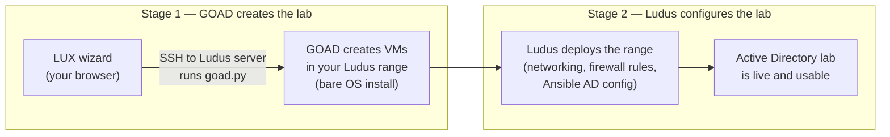

# Workflows

This page explains the two primary workflows in LUX and how they work together. Think of it as the "how does this actually work?" guide for operators — no assumed familiarity with GOAD or Ludus internals required.

---

## What is a Ludus Range?

A **range** is your private lab environment. It is a named collection of virtual machines (VMs) running on the shared Proxmox host. You define which VMs exist by editing a YAML config file; Ludus handles the actual creation, networking, and lifecycle management.

**One range = one isolated network slice of the Proxmox cluster.** Each user owns their own ranges and no one else can access them unless you explicitly share or an admin impersonates you.

You can edit the config as YAML on the Configuration page, step through the New Range wizard, or lay it out visually in the **Range Builder** (`/range/builder`). Deploy New Range offers Range Builder as a config method; it opens the canvas for that range. A Ludus / GOAD toggle chooses Ludus templates or a GOAD lab. After the range is deployed the toggle stays on that choice. Both draw domain boxes inside the subnet, and hosts that are not domain-joined stay in that subnet. Several domains share the subnet in a grid. A child-domain role is drawn in its child domain without rewriting the config. Resizing a subnet or domain rearranges what is inside it while the handle is still held, and the box stays selected. Compact packs every box to the smallest clean size. Templates are grouped into Windows and Linux. Validation errors are shown on the host. Role dependency lines are not drawn. The left rail loads a blueprint from the Ludus sources configured on the host, replaces this range's configuration, and redraws the canvas from that blueprint. After the first deploy that rail is a Range Viewer of the live machines, and you can still edit and deploy, the same as Configuration. Ludus mode draws each VM inside its VLAN and the router as the gateway to every VLAN. Drag installed templates to add VMs (a Windows template dropped on a domain joins it). In a Ludus range, drop a machine on a domain to join it, drop it on a subnet to move it, and drop a domain on a subnet to move that domain's machines. Draw a line between two networks or hosts, including a host and a subnet, to open the firewall rule builder with those VLANs and host addresses filled in, draw a line from a Windows VM to a domain to set its role, and draw a line between two domains to create a forest trust. The graph labels a forest trust as two-way or one-way and draws a parent-child trust as its own line. Subnet and domain boxes can be resized without losing the machines inside them. The inspector shows VM names with the range id filled in. The banner says when testing mode blocks internet and when internet is on. Delete removes the selected VM, firewall rule, or trust. Reset restores the last saved configuration. Leaving for another page keeps unsaved edits, and closing the tab asks before discarding them. Save keeps running after you leave. Deploy saves and starts the deploy, then links to Range Logs. These surfaces produce the same `range-config.yml` and deploy through Ludus, so you can move between them. On a GOAD range the builder shows lab VMs, domains, trusts, and VLANs read-only and you grow it by dragging an extension (the same install path as the GOAD page), while firewall edits are preserved across GOAD's Provide. How the canvas edits `range-config.yml` is listed under [Features](features.md).

**Range states** (plain English):

| State | What it means |
|-------|--------------|
| `NEVER_DEPLOYED` | Fresh range — no VMs have been built yet |
| `DEPLOYING` | Ludus is building or configuring your VMs right now (takes 5–30+ minutes) |
| `WAITING` | Ludus is in the middle of a deploy and waiting on a step |
| `SUCCESS` | Everything built successfully and is running |
| `ERROR` | Something went wrong during the last deploy — check the logs |
| `ABORTED` | You or an admin stopped the deploy in progress |
| `STOPPED` | Range powered off but config is retained |

---

## What is a GOAD Instance?

**GOAD** (Game of Active Directory) is an open-source toolkit that installs pre-configured Active Directory lab environments into your infrastructure. Lab types include **GOAD**, **GOAD-Mini**, **NHA**, **SCCM**, and more.

A **GOAD instance** in LUX is a record of one such installation. It tracks:
- Which lab type (e.g. GOAD-Mini)
- Which extensions are installed (e.g. Exchange, ADCS)
- Which Ludus range it lives in
- The history of every deploy, re-deploy, and action run against it

**One GOAD instance = one lab workspace.** Redeploys reuse the same workspace; you don't create a new instance each time.

---

## How Ludus + GOAD Work Together

This is the most important concept. GOAD and Ludus are two separate systems that LUX coordinates:



**Key point:** When you click **Deploy**, both stages happen automatically and in sequence. You watch both in the Deploy Status tab's live terminal.

- **GOAD's job** — Create the VMs, install Windows, configure the Active Directory domain structure via Ansible
- **Ludus's job** — Apply networking (IP ranges, routing), firewall rules, and any extra Ansible roles you defined in your range config

You do not need to trigger Stage 2 manually. LUX coordinates the handoff.

---

## Deploying a New Lab (step by step)

1. Go to **GOAD → Deploy New Instance**
2. Pick a **lab type** (e.g. GOAD-Mini)
3. Optionally add **extensions** (e.g. Exchange)
4. **Network Rules** lists rules from the selected extensions and from an existing range. The generated configuration shows that same list. Clearing every rule writes an empty list and keeps the existing range's other network settings. You can edit the list or skip the step
5. Click **Deploy**

What happens next (automatically):
1. LUX creates a dedicated Ludus range for this lab (named `<you>-<lab>`)
2. The GOAD wizard sends the install command to the Ludus server over SSH
3. The terminal on the Deploy Status tab shows live GOAD output as VMs are created and configured
4. When GOAD finishes, LUX merges the Network Rules list back and Ludus deploys the range
5. Once both stages complete, your lab is live

**The wizard redirects you to the instance page immediately after GOAD starts** — you do not need to stay on the wizard screen. LUX tracks progress server-side and resumes the log stream if you navigate back.

---

## Redeploying an Existing Lab

When you click **Redeploy** on an existing GOAD instance, LUX:
1. **Reuses the same workspace** — your GOAD configuration, instance ID, and range are preserved
2. **Clears the current VMs** in the background so you start with a clean slate
3. **Runs GOAD install** against the existing workspace

Use redeployment to:
- Recover from a broken state (e.g. Ansible failed partway through)
- Apply updated lab templates after a GOAD version upgrade
- Add extensions to an existing install

Redeployment is faster than a fresh deploy because the Ludus range and workspace directories already exist.

---

## The Firewall / Network Rules Queue

GOAD's install rewrites the Ludus range config, so LUX saves the **Network Rules** list and merges it back after GOAD finishes, then starts a Ludus deploy with the network tag. Existing rules stay in their stored order. The rest of that merge is under Range YAML vs Range Configuration in [Features](features.md).

You do not need to do anything. The Deploy Status tab shows a "Applying network rules..." step when this is happening. The entire process runs on the server — you can safely navigate away.

---

## Admin: Managing Multiple Users (Range Impersonation)

Admins can **view and manage as another user** — seeing their ranges, GOAD instances, and running tasks exactly as that user would. This is called **impersonation**.

**How to activate it:**
1. Open any user's row in the Users or Admin panel
2. Click **Impersonate** (requires entering that user's API key, which admins can read from the Users page)
3. A banner appears at the top of the screen showing who you are impersonating
4. All pages and API calls now run as that user
5. Click **Stop Impersonating** in the banner to return to your own context

**What changes when impersonating:**
- The GOAD instances list shows the other user's labs (not yours)
- Range operations (deploy, abort, config edit) target the other user's ranges
- GOAD deploys create ranges owned by the impersonated user
- All API calls to Ludus use the impersonated user's API key from the session cookie

**What does NOT change:**
- The noVNC console still uses each user's own PAM password — you cannot open another user's VM console unless you know their password
- Your own admin session and capabilities remain active; you can exit impersonation at any time

**Range naming convention:** GOAD ranges are named `<username>-<instanceId>` so it is always clear which user owns a range. When impersonating, new ranges are created under the impersonated user's name.

---

## Server-Side Durability

LUX runs post-deploy coordination (range linkage, firewall rule application) on the server. Even if you:
- Close the browser tab
- Navigate to a different page
- Lose your network connection

...the GOAD install continues on the Ludus server, and LUX's server-side workflow applies your firewall rules and links the new instance to your range when GOAD finishes. You can return to the instance page at any time to see the current status.

---

## What is LudusHound?

**[LudusHound](https://github.com/bagelByt3s/LudusHound)** (bagelByt3s) turns BloodHound data into a Ludus range YAML that Ansible roles use to rebuild AD objects and relationships. Unlike GOAD (which runs a long provisioner), LudusHound **generates config**; Ludus then deploys VMs and runs the roles.

**Operator prerequisite:** clone the repo on the Ludus host:

```bash
git clone https://github.com/bagelByt3s/LudusHound /opt/LudusHound
```

LUX builds the binary and installs `bagelByt3s.ludushound` from the local collection tarball. Packer templates named in the generated YAML (plus the Ludus router template) must be built before deploy.

## Deploying with LudusHound (step by step)

1. Go to **Integrations → LudusHound**
2. Install collection (+ build binary if needed) from the readiness card — LUX installs Go on the Ludus host under `/usr/local/go` when missing
3. **Deploy New** — pick Full replica or Attack Path
4. For Full + live Neo4j: choose **External**, **Managed CE**, or **FilesMap**; probe Neo4j when using live mode
5. Enter AliveComputers / Attack Path JSON + DomainController
6. Pick or create a Ludus range → **Generate YAML** → confirm templates are built → **Deploy range**

Live Neo4j must already contain SharpHound data (or use FilesMap / Attack Path instead).
